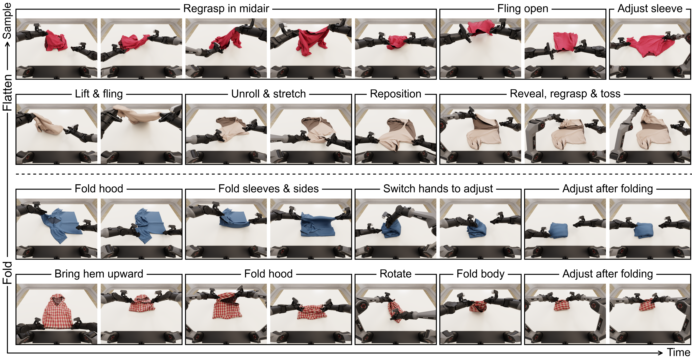
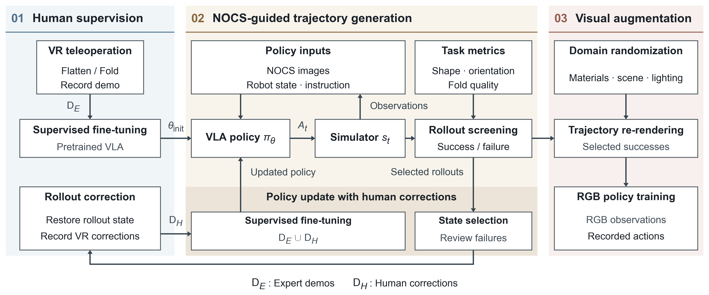
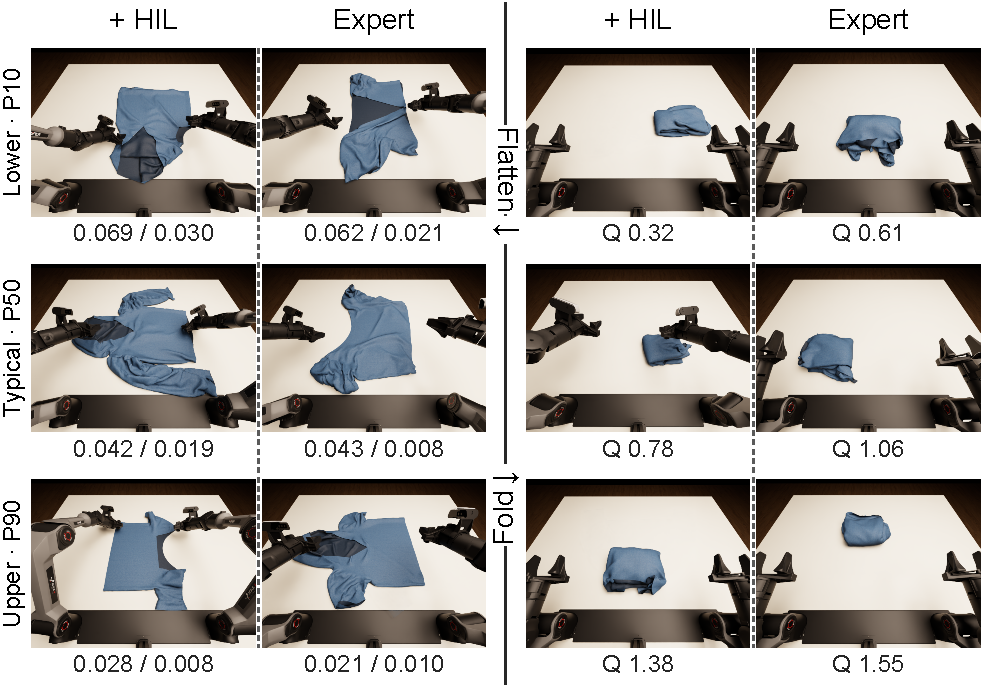
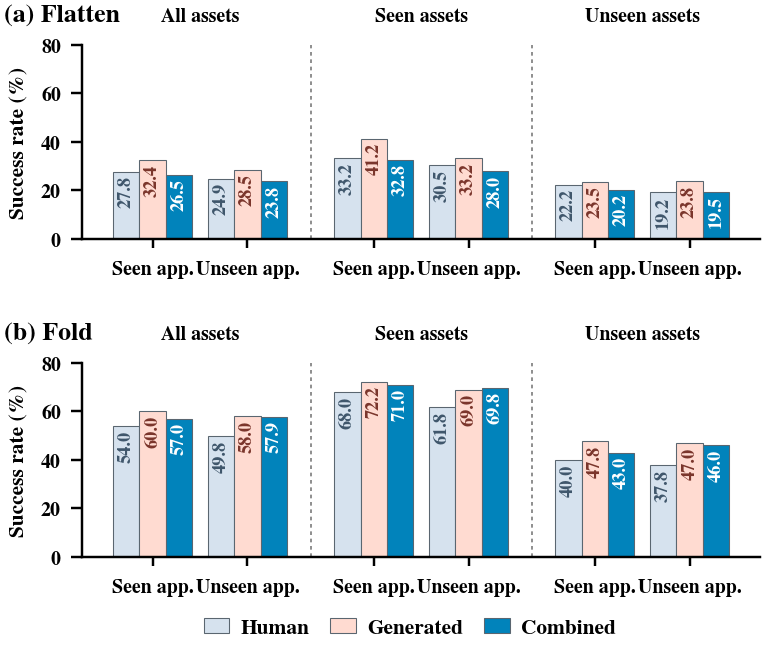

# ClothDojo：面向服装展平与折叠的闭环评测与学习式数据生成

> 中文内容稿，面向 ICRA 2027，更新于 2026-09-09。按未来十天内拟补齐的论文组织；【待实现】与【待实验】明确标记未完成环节，已有数字注明证据范围。投稿范围、证据来源和十天补齐顺序见[作者备忘](submission_plan_zh.md)。本稿是内容源，尚未完成英文八页排版。

## 摘要

服装展平与折叠要求机器人在操作中逐步辨清衣物结构，并随形变调整动作。我们提出 ClothDojo，将多样服装上的动态双臂交互与学习式轨迹生成结合，为通用机器人策略提供可规模化的仿真研究平台。我们用人工示范与纠正数据微调现有视觉—语言—动作模型（VLA），作为轨迹生成的数据代理。我们将不同服装的规范坐标（NOCS）统一编码为表面颜色，为数据代理提供跨服装共享、且不随形变改变的位置参照。代理在不同服装与初态上自主生成操作轨迹，平台依据任务完成指标自动筛选成功轨迹。随后，平台在保持机器人与衣物运动不变的条件下，通过外观随机化重渲染生成用于普通 RGB 策略训练的数据，并在固定测试条件下对训练后的策略进行闭环评测。

**图 1. ClothDojo 连接数据生成、数据扩展与闭环评测。**（01）特权视觉数据代理生成展平与折叠轨迹，图中并列展示规范坐标（NOCS）与普通 RGB 外观；（02）通过跨机器人本体的轨迹重定向与视觉随机化扩展数据；（03）汇集服装资产与操作轨迹；（04）通过连续指标、策略排名和敏感性分析组织评测。

## 1. 引言

服装展平与折叠把视觉理解和双臂控制绑定在持续变化的长程操作中。服装结构和外观各异，褶皱与自遮挡隐藏关键部位，每次接触又改变布料形态和后续操作条件。策略必须根据执行结果持续调整，跨服装训练因而需要覆盖大量初态的连续轨迹。真机采集这些轨迹耗时，还需反复布置难以复现的复杂初态；机器人和场景差异进一步限制数据与实验复用，使规模化训练和评测成本高昂。

仿真能够复用初态并批量运行，降低交互成本，但成功轨迹仍需设计或采集。任务专用 primitive、基于关键点的规划和预设步骤可以自动生成轨迹，其动作形式或任务结构需要预先设计；人工遥操作可以随执行结果继续调整，却仍受逐条采集成本的限制。图 2 中的自主轨迹展示了展平中的空中换抓，以及折叠中的换手与折后调整。如何规模化生成包含这些行为的轨迹，是本文关注的问题。

真机叠衣系统表明，示范、人工纠正和自主经验可以构成有效的数据闭环。受此启发，ClothDojo 将闭环策略用作仿真数据代理，在新状态中自主扩展轨迹。人工示范首先用于 SFT，数据代理随后进行批量 rollout；任务指标自动筛选成功轨迹，失败轨迹进入 HIL，新增纠正继续训练下一轮代理。仿真还将 NOCS 编码为布料外观，通过 VLA 原有的图像接口提供规范位置先验，让代理在明确的表面位置参照下学习布料交互。人力因此集中于示范与必要纠正，轨迹规模则由代理自主扩展。

如图 1 所示，ClothDojo 以双臂机器人与布料的动态交互为基础，贯通学习式轨迹生成、数据扩展与闭环评测。本文贡献如下：

1. **闭环数据生成流程。** 在双臂机器人—布料动态交互环境中统一人工示范与纠正、批量 rollout 和自动筛选，将人类的适应性操作转化为可扩展的数据生成能力。
2. **基于特权视觉的数据代理。** NOCS 通过 VLA 原有的图像接口提供规范位置先验；经 SFT 与 HIL 训练的代理直接预测连续双臂动作，无需任务专用 primitive 或预设步骤。
3. **轨迹数据与闭环评测。** 自主生成的展平轨迹集合已覆盖 500 件服装，每件 10 条，共 5,000 条。折叠轨迹仍在生成，目标为两项任务合计 10,000 条；最终可用数量以筛选与导出结果为准。已有独立展平与折叠策略评测，普通 RGB 下游及连续执行结果待补。

**图 2. 自主策略生成的长程行为包含多样的动作衔接与中途调整。** 展平轨迹将空中换抓、动态展开与局部整理连接起来；折叠过程中可见换手、旋转和折后调整。各行是独立 rollout 的非等间隔关键帧，按时间从左至右排列；框上文字标注观察到的行为，画面由记录的仿真状态重渲染。

## 2. 相关工作

### 2.1 服装操作策略

许多方法先为服装展平与折叠定义一组任务专用 primitive。策略从视觉观测中选择 primitive，或预测抓取位置等参数；连续运动由预设控制器完成 [FlingBot; ClothMate; Cloth Funnels; SpeedFolding; UniFolding]。策略可以在 primitive 之间重新观测，部分 primitive 也利用反馈完成拉伸等环节。这类动作先验缩小了学习空间，已用于多类服装的展平与结构化折叠。

另一条路线从数据中学习连续动作。近期 VLA 直接预测连续 action chunks，已在真机上完成从取衣到展平、折叠和堆放的长程操作 [π*0.6; χ0; DeMaVLA]。这些系统先用人类示范建立基本行为，再以自主 rollout 暴露失败，并通过人工纠正覆盖策略实际遇到的状态。这种闭环将动作次序、双臂配合和中途调整也交给策略学习。

### 2.2 仿真环境与数据生成

现有服装仿真平台提供多类服装资产和机器人—布料动态交互，覆盖展平、折叠等任务 [GarmentLab; DexGarmentLab; LeHome; SimWeaver]。这些平台的公开轨迹主要来自任务 primitive、示范迁移或少量遥操作。

自动扩展轨迹的方法主要有两类。程序化方法按照关键点、任务阶段或折叠模式构造轨迹 [FoldNet; Instant-Fold]；示范迁移方法将分段行为扩展到新的资产和初态，并重新执行得到物理轨迹 [SoftMimicGen; SIM1]。前者能够批量执行明确的任务流程，后者能够复用已有示范，两条路线都有效扩大了仿真数据规模。现有规模化结果主要集中于步骤明确的折叠任务。但在严重褶皱展平中，操作路径会随布料状态变化，固定流程和分段示范难以直接复用。

ClothDojo 将已在真机服装操作中验证的示范—rollout—纠正闭环用于仿真轨迹生成。数据代理从人类交互中学习，再在多样服装和复杂初态上自主 rollout（行为示例见图 2）。

## 3. 方法

如图 3 所示，ClothDojo 将物理轨迹生成与视觉数据扩展分开。我们首先用人工示范与纠正训练 NOCS 条件化的轨迹代理，再让代理在未见服装和未见褶皱初态上自主执行。任务指标从 rollout 中筛选成功轨迹，这些轨迹随后以不同外观重渲染，用于训练普通 RGB 策略。一次成功的物理执行由此可以产生多个视觉版本，而无需重新生成动作。

**图 3. NOCS 引导的数据生成流程概览。** 专家示范 \(\mathcal D_E\) 初始化轨迹代理；对自主执行中的失败，操作者从选定状态恢复并通过 VR 提供纠正 \(\mathcal D_H\)。两类人工数据共同更新代理，成功 rollout 则经外观重渲染生成 RGB 训练数据。

### 3.1 交互环境与任务

ClothDojo 在 Newton 中结合 MuJoCo 机器人动力学与 Style3D 布料模拟，提供连续双臂控制。VR 遥操作与策略执行采用相同的物理模拟，使人工示范、纠正和自主执行共享一致的机器人—布料交互。图 2 展示了该环境中的自主策略轨迹：策略在长时程执行中持续响应布料状态，完成多次抓取、双臂协同和中途调整。

我们从大规模参数化服装数据集 GarmentCodeData [GarmentCodeData] 中转换出超过一万件可用于仿真的服装资产，并从中选取 500 件构成本研究的实验集合。如图 4 所示，该集合在衣长、围度、袖长和袖宽上具有较大跨度，并涵盖无袖、连帽、深领、背部镂空、左右不对称及其他异形剪裁。

**图 4. 实验服装资产的几何多样性。** 图中展示了 500 件实验资产中的大部分，涵盖不同衣长、围度、袖型、领型和非对称剪裁。所有服装均以自然沉降形态呈现，并保留相对物理尺寸。

**展平**从随机悬挂、释放并自然沉降形成的褶皱状态开始，目标是将服装整理为正面朝上的自然展平状态。服装朝向桌面的四个方向均可，桌面内的位置不作要求。**折叠**以上述展平任务的成功终态为初态，目标是将服装整理为紧凑、平整、少外漏的矩形包。不限定长宽比、折线或动作次序。两项任务的初态均预先保存，使不同策略能够从相同状态重复执行；定量成功判据见第 4.1 节。

### 3.2 NOCS 条件化的轨迹代理

为给代理提供随布料运动保持一致的表面位置参照，我们将规范形态中的归一化坐标（NOCS）编码为服装纹理。设规范网格顶点为 \(v_i\)，逐轴边界为 \(v_{\min}\) 和 \(v_{\max}\)，其归一化坐标为
\[
u_i=\frac{v_i-v_{\min}}{v_{\max}-v_{\min}},
\]
三个分量分别编码为 RGB 通道。颜色在规范形态中确定，随后附着于对应顶点，不随当前褶皱重新计算；不同服装上相近的相对位置也具有相近颜色。代理因此可以通过原有图像接口使用这一位置参照，但只能观察可见表面，跨服装的颜色对应也不等于严格的语义对应。

我们以 [\(\pi_{0.5}\)](https://arxiv.org/abs/2504.16054) 的预训练模型为基座，分别微调展平和折叠轨迹代理。代理通过模型原有的视觉接口接收 NOCS 图像，同时输入机器人状态和任务指令，预测双臂关节目标与夹爪命令。执行时，代理仅执行预测动作序列的前缀，随后根据新的观测重新预测，从而闭环生成完整轨迹。

### 3.3 从示范与纠正学习

我们通过 VR 分别采集展平与折叠示范。采集折叠示范时，我们恢复对应展平示范的终态，由操作者接续完成折叠。两项任务独立记录，分别用于各自代理的 SFT，并沿用基座的动作预测目标。示范的资产覆盖与采集量见第 4.2 节。

为覆盖代理实际访问的状态，我们采用类似 DAgger [DAgger] 的迭代数据聚合。代理首先在不同服装与初态上自主 rollout；对于需要纠正的执行，我们选择介入时刻并恢复仿真，由操作者通过 VR 从该状态继续完成任务，记录纠正轨迹 \(\mathcal D_H\)。随后，我们将纠正数据与原始示范 \(\mathcal D_E\) 合并，沿用相同的监督目标更新代理。监督动作均来自人类，自主 rollout 在这一阶段用于提供纠正起点。

为增加左右臂分工互换的训练样本，我们采用双臂形态对称增强 [GR-RL]，将每条人工轨迹整体左右镜像。在轨迹的每一帧中，服装状态左右翻转，两条机械臂及夹爪的状态和动作相互交换并作对应变换。镜像轨迹随后通过状态回放重渲染 NOCS 观测。每条人工轨迹由此产生一个镜像样本，但不计为新增人工示范。

### 3.4 从成功轨迹生成 RGB 数据

训练完成后，我们冻结轨迹代理，并让其在未见服装与未见初态上自主 rollout。系统根据第 4.1 节的成功判据自动筛选执行结果，仅保留成功轨迹。

对于每条成功轨迹，我们从 34 种服装基础材质（39 个配色版本）、17 种桌面材质、12 种地面材质和 8 个背景场景中采样外观，并连续采样光源位置、强度和色温。每组外观在整条轨迹内保持不变；系统通过状态回放重渲染 RGB 图像，同时保留原有的机器人与服装运动、机器人状态和动作目标。重渲染数据用于监督训练下游策略，其输入为 RGB 观测、机器人状态和任务指令，不包含 NOCS。同一条物理轨迹可以生成多个视觉版本，但仍只计一次操作经验。实际训练与评测采用的外观子集在实验设置中说明。

## 4. 实验

### 4.1 评价指标与成功判据

我们在执行过程中逐帧计算任务指标，并要求指标连续达标，避免将瞬时经过目标状态计为成功。

**展平。** 我们以同一服装的自然铺平状态为参考，将当前状态与参考状态在桌面内进行平移和旋转对齐。对齐后的平均顶点距离定义为形变误差 \(d_{\mathrm{def}}\)，估计朝向与最近合法朝向之间的差异定义为朝向误差 \(d_{\mathrm{rot}}\)。两项误差均按参考服装的平面尺度归一化。我们从 182 件服装的 890 个专家终态中估计正常展平误差的上界，得到两项阈值分别为 \(0.088\) 和 \(0.043\)。当两项误差连续 \(1\,\mathrm{s}\) 不超过对应阈值时，判定展平成功。

**折叠。** 由于任务允许多种折叠结果，我们不使用单一目标模板，而是根据面积压缩、整体平整度、顶面矩形完整度、三维材料重叠和贴桌程度计算折叠质量分数 \(Q\)。该分数由专家终态、HIL 成功状态和失败 rollout 拟合，并按服装划分数据进行折外阈值标定，得到阈值 \(0.142\)。当 \(Q\geq0.142\) 连续保持 \(3\,\mathrm{s}\) 时，判定折叠成功。

### 4.2 轨迹代理的生成性能如何？

我们检验 NOCS、镜像增强和 HIL 能否逐步提高代理生成合格轨迹的能力。代理先从专家示范中学习，再通过 HIL 纠正覆盖自主执行中遇到的失败状态；两类人工数据及其服装覆盖见表 1。折叠示范从对应的展平终态开始；由于这类初态较为可控，我们减少了单件服装上的重复示范，将采集预算用于覆盖更多服装。所有轨迹在训练前均经过质量清洗，表中同时给出第 3.3 节镜像增强后的规模。

**表 1. 轨迹代理的人工训练数据分布。**

| 任务 | 专家示范（原始 → 增强后 / 资产） | HIL 纠正（原始 → 增强后 / 资产） |
| --- | ---: | ---: |
| 展平 | 890 → 1,780 / 182 | 201 → 402 / 88 |
| 折叠 | 537 → 1,074 / 156 | 213 → 426 / 125 |

我们从仅使用纯白服装观测和专家示范的 White 配置开始，依次加入 NOCS、镜像增强和 HIL 纠正，形成四个累积配置。所有模型均从预训练的 \(\pi_{0.5}\) 初始化，展平与折叠分别训练。每项任务在 200 件服装、每件 4 个预存初态上评测，共 800 次闭环执行，所有模型共享初态和执行配置。测试服装按是否出现在完整人工训练池 \(\mathcal D_E\cup\mathcal D_H\) 中划分为 Seen 和 Unseen；展平两组各 100 件，折叠分别为 130 件和 70 件。表中报告总体及两个子集的成功率，并按照第 4.1 节统计成功轨迹的质量。Expert 行以通过成功判据的人工示范终态作为质量参照，不参与成功率比较。

**表 2. 展平轨迹代理的闭环评测结果。**

| 配置 | 全体 ↑ | Seen ↑ | Unseen ↑ | Def. ↓ | Rot. ↓ |
| --- | ---: | ---: | ---: | ---: | ---: |
| White | 24.8 | 26.3 | 23.3 | 0.081 | 0.024 |
| + NOCS | 62.9 | 66.3 | 59.5 | 0.080 | 0.024 |
| + Mirror | 69.6 | 76.0 | 63.3 | 0.080 | 0.025 |
| + HIL | **76.5** | **82.3** | **70.8** | 0.080 | 0.024 |
| Expert | — | — | — | 0.068 | 0.019 |

NOCS 带来了最大的展平成功率增益，镜像增强和 HIL 纠正在此基础上继续改善结果。这一趋势同时出现在 Seen 和 Unseen 服装上，而成功轨迹的 Def. 和 Rot. 基本不变。后续改进主要增加了成功轨迹的数量，同时保持了终态质量。

**表 3. 折叠轨迹代理的闭环评测结果。**

| 配置 | 全体 ↑ | Seen ↑ | Unseen ↑ | \(Q\) ↑ |
| --- | ---: | ---: | ---: | ---: |
| White | 55.1 | 61.0 | 44.3 | 0.809 |
| + NOCS | 57.6 | 61.2 | 51.1 | 0.779 |
| + Mirror | 60.5 | 64.2 | 53.6 | 0.846 |
| + HIL | **70.0** | **73.7** | **63.2** | 0.825 |
| Expert | — | — | — | 1.037 |

折叠呈现相似但更缓慢的提升：NOCS 和镜像增强带来小幅增益，HIL 则进一步改善了 Seen 和 Unseen 服装上的成功率。各配置的 \(Q\) 没有随成功率同步上升。由于 \(Q\) 只在成功轨迹上统计，每一行对应的成功子集不同，因此它用于判断生成结果是否保持可用质量，需要与成功率结合解读。

人工示范在细粒度指标上整体更好，但图 5 中模型在不同质量分位上的展平与折叠结果均保持了可接受的视觉质量，可用于后续数据生成。

**图 5. 模型 rollout 与人工示范产生了视觉质量相近的成功终态。** 各行分别展示两类轨迹在 P10、P50 和 P90 质量分位上的释放后状态。展平图像下方依次标注 Def. 和 Rot.，数值越低越好；折叠图像标注 \(Q\)，数值越高越好。

### 4.3 自动生成的数据对视觉策略有何价值？

我们从同一预训练 \(\pi_{0.5}\) 权重出发，使用三类数据分别训练展平与折叠 RGB 策略：**Human** 为人工采集轨迹，**Generated** 为自动生成并通过成功判据筛选的轨迹，**Combined** 为两者的并集。各组的轨迹规模和服装覆盖见表 4。

**表 4. RGB 策略的训练数据（轨迹数 / 服装数）。**

| 任务 | Human | Generated | Combined |
| --- | ---: | ---: | ---: |
| 展平 | 1,120 / 217 | 3,992 / 400 | 5,112 / 470 |
| 折叠 | 748 / 242 | 3,856 / 399 | 4,604 / 458 |

我们在统一测试集上分别考察服装与外观泛化。Seen 集包含同时出现在三类训练数据中的 100 件服装，Unseen 集包含均未出现的另外 100 件服装，每件服装使用四个固定的新初态。每个初态分别搭配 Seen 和 Unseen 外观：Seen 外观从训练随机化范围中采样，Unseen 外观使用训练中未出现的服装纹理、支撑表面、背景和光照。所有策略共享相同的服装、初态和外观设置。

**图 6. 自动生成的轨迹能够训练有效的 RGB 策略。** 在共同的 Seen 和 Unseen 服装集合上，分别使用 Seen 和 Unseen 外观进行评测。

Generated 在所有评测条件下均优于 Human。尽管生成轨迹的终态不如人工轨迹精细，但其轨迹规模更大、服装覆盖更广。这一结果表明，对当前 RGB 策略而言，更大的操作覆盖可能比更精细的终态更有训练价值。

直接混合人工与生成轨迹没有进一步改善性能。Combined 在展平上整体低于 Human；在折叠上虽高于 Human，整体仍未超过 Generated。Combined 的数据量最大却未取得最佳结果，说明不同来源数据的分布及其混合方式会影响训练效果。

新服装比新外观带来更大的性能下降。这一趋势同时出现在三类训练数据和两个任务中，说明服装结构仍是当前更主要的泛化困难，也体现了扩大训练资产覆盖的必要性。

### 4.4 数据规模与服装覆盖

【建议补充，尚未执行】

固定专家数据、训练服装集合和外观采样，分别加入零、四分之一和全部生成轨迹，并保持总训练帧预算一致。生成轨迹采用按服装分层的嵌套子集；零和全部的端点可复用第 4.3 节的随机外观组，只需增加一个中间规模。这条曲线检验增加操作经验后，收益是否继续增长。

若要进一步检验服装覆盖的作用，则在生成轨迹总数相同的条件下，比较“较少服装、每件较多轨迹”与“较多服装、每件较少轨迹”。固定专家数据、训练预算及各组共同留出的测试服装，以区分练习密度和资产广度。

随结果报告实际可用轨迹数、覆盖服装数、生成尝试数、人工纠正时间及仿真/渲染 GPU 小时。数据规模按唯一物理轨迹计数，并计入补采与失败尝试的成本。

### 4.5 质量与失败分析

【补充分析待完成】

按初态难度、服装尺寸和形态分组报告成功率，定位稳定模型在哪些条件下失效；在共同成功的测试样本上比较质量，检查整体质量均值是否受到成功子集变化的影响。代表片段与分组统计对应，解释动作过程和最终状态。

折叠 DAgger 的当前训练异常由独立诊断处理，排除异常后再纳入方法比较。现有低成功率不作为折叠任务的固有困难或纠正数据的负面效果；诊断进度也不替代正式对照结果。

> 作者记录：示范规模与终态恢复关系见[来源核验](experiments/demonstration_inventory_20260910.md)，现有成功数见[结果汇总](experiments/task_success_summary.md)。评分来源见[评分细节](experiments/evaluation_protocol_notes_zh.md)与[折叠质量说明](../docs/fold_quality.md)。实验优先级和对照边界见[实验证据建议](experiments/experiment_priorities_zh.md)，具体下游运行安排见[RGB 方案](experiments/downstream_rgb_generalization_plan_zh.md)。本段不进入论文正文。

## 5. 局限

ClothDojo 当前服装集合以上身相关形态为主，结论不直接覆盖裤装或任意可变形物体。规范颜色依赖仿真中的网格对应，适用于训练数据生成，不是真机直接可用的感知输入；其优势也可能同时来自几何位置和局部颜色辨识，单一纯白对照不能分离二者。

任务指标同样有边界。展平使用模板对应并忽略 XY 平移，朝向项以模板诱导的归一化顶点位移表示，数值也依赖服装形状；顶点等权使距离受网格空间采样密度影响。折叠评分由五个仿真几何特征学习，只评价当前可观察的整理质量，不确认内部层序，也未证明可以作为策略训练的唯一奖励。现有验证集参与过指标迭代，且 1 mm 扰动仍会影响个别边界状态，因此最终论文需明确其适用范围与误差。

固定初态和运行身份提高了比较条件的可追溯性，但未消除布料求解器的非确定性。成功筛选也会偏向生成策略容易处理的状态。完整失败记录、难度分布与重复实验能够揭示这些限制，却不能消除它们。高保真重渲染只改变视觉因素；没有真机闭环实验和动力学验证时，不能将仿真内收益推广为 sim-to-real 成功。

## 6. 结论

ClothDojo 将服装闭环评测与学习式数据生成组织在同一轨迹体系中：固定测试分布检验策略能力，NOCS 条件化策略在新状态上产生物理轨迹，随机化重渲染再将这些行为转为普通视觉训练数据。已有配对实验支持 NOCS 改善展平生成成功率，并提供了 200 件服装上的生成策略基线。最终结论仍取决于折叠策略评测和 RGB 下游四组对照：只有新物理轨迹在共同预算下带来可复现的闭环收益，才能确认学习式生成提供了单靠外观扩展不能替代的数据价值。
